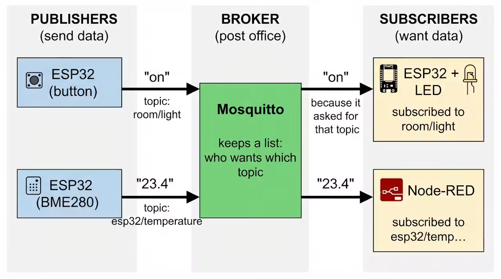
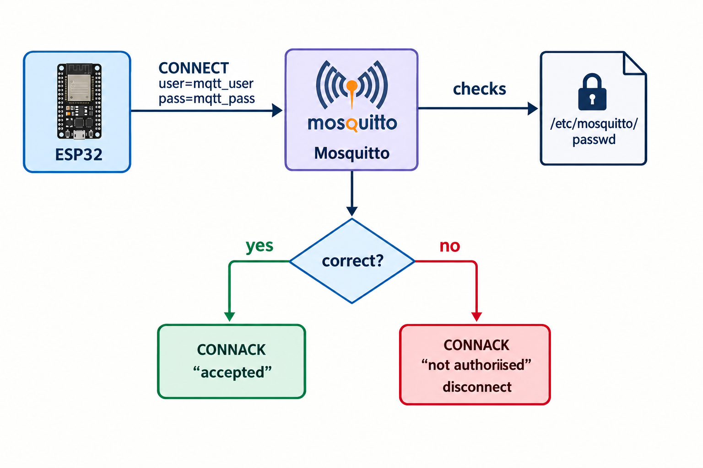

#  Understanding MQTT(Message Queuing Telemetry Transport)

This is a lightweight open messaging protocol that was developed for constrained environments such as M2M (Machine to Machine) and IoT (Internet of Things), where a small code footprint is required.

MQTT is based on the **Pub/Sub** messaging principle of:
* Publishing messages and subscribing to topics.
* The protocol efficiently packs messages to minimize overhead.


The MQTT specification recommends TLS (**Transport Layer Security**) as a transport option to secure the protocol using port **8883** (secure-mqtt), as the MQTT protocol does not provide security on its own.

Constrained devices can benefit from using TLS session resumption to reduce the reconnection cost.

##  The problem MQTT solves

IoT devices are small, often on batteries, and on unreliable Wi-Fi. They need to send small messages ("23.4 °C", "on") to whoever is interested, without knowing who that is.

MQTT solves this with **publish/subscribe** through a middleman called the **broker**:

ESP32 Example:



```
   PUBLISHERS                     BROKER                      SUBSCRIBERS
   (send data)               (post office)                  (want data)

 ┌────────────┐  "on"    ┌──────────────────┐   "on"    ┌──────────────┐
 │ ESP32      │─────────►│                  │──────────►│ ESP32 + LED  │
 │ (button)   │ topic:   │    Mosquitto     │  because  │ subscribed to│
 └────────────┘ room/    │                  │  it asked │ room/light   │
                light    │  keeps a list:   │  for      └──────────────┘
 ┌────────────┐ "23.4"   │  who wants which │  that     ┌──────────────┐
 │ ESP32      │─────────►│  topic           │  topic    │ Node-RED     │
 │ (BME280)   │ topic:   │                  │──────────►│ subscribed to│
 └────────────┘ esp32/   └──────────────────┘  "23.4"   │ esp32/temp…  │
                temperature                             └──────────────┘
```

**Key Idea:**

**Publishers** and **Subscribers** never talk to each other directly. They do not know each other's IP addresses. Everyone only knows the broker's IP. 

This is called **decoupling**: one can add, remove or replace devices without changing the others.


## The five MQTT concepts 

1. **Broker** - The server in the middle that receives every message and forwards it. (*Mosquitto*, on the *Laptop (Project 1)* or the (*Pi in Project 2-4*)).

2. **Client** - Any program/device that connects to the broker. (*`mosquitto_pub`, `mosquitto_sub`, the `ESP32 sketches`, `Node-RED`*)

3. **Topic** - The "address" a message is sent to, like a folder path. (*`test`, `room/light`, `room/light/state`, `esp32/temperature`*)

4. **Subscribe** - A client telling the broker "send me everything on this topic". (*The LED ESP32 subscribes to `room/light`*)

5. **Quality of Service (QoS)** - How hard the broker tries to deliver. (*0, 1 or 2 (below)*)

Topics do not need to be created in advance. They exist as soon as someone publishes.

## Quality of Service (QoS)

* 0 - At most once: Sent once, no confirmation, may be lost. Example:(`Shouting across a room.`)

* 1 - At least once: Re-sent until confirmed, may arrive twice. Example:(`Text message with read receipt`)

* 2 - Exactly once: Four-step handshake, arrive exactly once. Example:(`Registered mail`)

## What actually travels over the network

Every MQTT conversation is made of small **packets**. You will literally see these names printed when you run `mosquitto -v` (broker) or `mosquitto_sub -d` (client):
```
   CLIENT                                   BROKER
     │                                         │
     │ ── CONNECT (client ID, user, pass) ───► │   "Hi, I'm Example_Light"
     │ ◄────────────────────────── CONNACK ─── │   "OK, you're in"
     │                                         │
     │ ── SUBSCRIBE (room/light) ────────────► │   "Send me room/light"
     │ ◄──────────────────────────── SUBACK ── │   "Done"
     │                                         │
     │ ◄─────────────── PUBLISH (room/light, "on")   someone else published
     │                                         │
     │ ── PINGREQ ───────────────────────────► │   every 60 s: "still alive"
     │ ◄─────────────────────────── PINGRESP ─ │
     │                                         │
     │ ── DISCONNECT ────────────────────────► │   "Bye"
```
* **Retain flag**: the broker remembers the last message on a topic and gives it to anyone who subscribes later.

* **Last Will and Testament (LWT)**: a message the client registers when connecting. If the client disappears without a DISCONNECT, the broker publishes it on the client's behalf (e.g. "sensor offline").

## Security
The broker enforces security. Three ways it can check who a client is: **client ID**, **username/password**, or **certificates**. From Project 2 on, we use **username** and **password**:



```
   ESP32 ── CONNECT user=mqtt_user pass=mqtt_pass ──► Mosquitto
                                                       │ checks /etc/mosquitto/passwd
                                                       ▼
                                   correct? ── yes ──► CONNACK "accepted"
                                            └─ no ───► CONNACK "not authorised", disconnect
```


## MQTT vs Kafka


