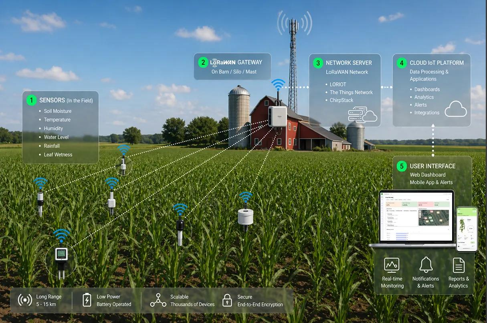
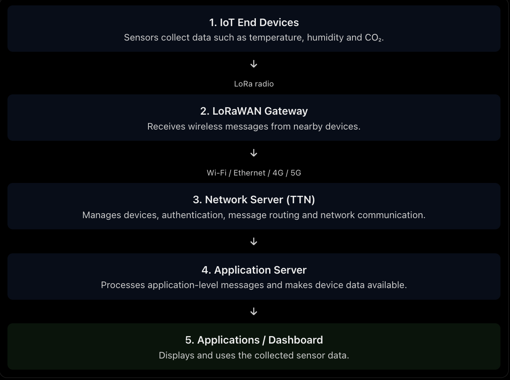

# LoRaWAN Implementation Guide

## PART 1: Understanding LoRa and LoRaWAN
LoRa (Long Range) is a wireless communication technology designed for IOT devices that need to transmit small amounts of data over long range distances while consuming very little power.

Example 
_Imagine you have a temperature sensor installed on a farm. You want it to send temperature readings to your computer, but the sensor is several kilometers away._

Using ordinary Wi-Fi may not be practical because:
* Wi-Fi has relatively limited coverage.
* It consumes more power.
* The sensor may not have access to a Wi-Fi network.

LoRa solves this by allowing devices to communicate over longer range distances with low power consumptions.

Example applications:

* Smart agriculture: Monitoring soil moisture and temperature.
* Smart cities: Monitoring waste bins.
* Environmental monitoring: Measuring air quality.
* Smart buildings: Monitoring humidity and temperature.
* Asset tracking: Tracking equipment and containers. 




<p><strong>LoRa Gateway </strong></p> 


### What is LoRaWAN?
LoRa and LoRaWAN are related, but they are not the same thing.

| LoRa | LoRaWAN |
| --- | --- |
| Wireless radio technology | Communication protocol |
| Handles physical wireless transmission | Handles network communication |
| Defines how radio signals are transmitted | Defines how devices communicate with the network |
| Provides long-range communication | Provides device authentication, security, and network management |

Simple analogy:

Think of LoRa as the road on which vehicles travel, while LoRaWAN is the traffic system that manages how the vehicles communicate and move.

Remember:
* LoRa = Physical radio communication. 
* LoRaWAN = Network protocol built around LoRa.

### Understanding the LoRaWAN architecture



**_Understanding each component_**

**1. End device**

This is the physical IoT device containing a microcontroller and sensors.

For example:

* ESP32
* Arduino
* Temperature sensor
* Humidity sensor
* CO₂ sensor

Its job is to collect information and transmit it using LoRa.

**2. LoRaWAN Gateway**

The gateway acts as a bridge between the LoRa radio network and the internet.

It receives LoRa messages from multiple devices and forwards them to the network server.
- An important distinction: the gateway does not normally interpret the application data. That is handled further along the network.

**3. Network Server**
The Network Server manages the LoRaWAN network.

Its responsibilities include:
* Managing device communication.
* Checking message integrity and security.
* Handling duplicate messages received by multiple gateways.
* Managing message routing.

**4. Application Server**

The Application Server handles application-level data and makes it available to applications through integrations and APIs.

**5. Applications**

These are the interfaces used to view or process the information.

For example, a dashboard could display:

| Sensor | Reading |
| --- | --- |
| Temperature | 25.4°C |
| Humidity | 60% |
| CO₂ | 420 ppm |


### Understanding the complete program flow
Lab Exercise 

```bash
iotsuwo-hs-2026-course-main-lora/
│
└── lora/
    │
    ├── README.md
    │
    └── lora-grove-extension-board/
        │
        ├── libraries/
        │   ├── Adafruit_CCS811-master/
        │   ├── Adafruit_Si7021-master/
        │   └── arduino-lmic-master/
        │
        └── ttn-otaa/
            └── ttn-otaa.ino
```


Configure an Arduino LoRaWAN device, connect it to The Things Stack, collect environmental sensor readings and successfully transmit the readings to the TTN application.


_What you need before starting_

Hardware

* Arduino Uno.
* LoRa development board / Grove LoRa extension board.
* Si7021 temperature and humidity sensor.
* CCS811 CO₂ sensor.
* USB cable.
* Computer.

Software
- Arduino IDE.
- The Things Stack (TTN) account.
- Arduino LMIC library.
- Adafruit CCS811 library.
- Adafruit Si7021 library.


Navigate to:

```bash
lora/
  lora-grove-extension-board/
    ttn-otaa/
      ttn-otaa.ino
```

Open `ttn-otaa.ino` using Arduino IDE.


_Understanding the libraries_

| Library | Purpose |
| --- | --- |
| Adafruit\_CCS811 | Communicates with the CO₂ sensor |
| Adafruit\_Si7021 | Communicates with the temperature/humidity sensor |
| Arduino LMIC | Handles LoRaWAN communication |


What is LMIC?

LMIC stands for LoRaMAC-in-C. It implements the LoRaWAN MAC layer and handles tasks such as:
- Joining a LoRaWAN network.
- Sending data packets.
- Receiving network responses.
- Managing transmission timing.
- Handling acknowledgements and network events.
Think of LMIC as the software that allows your Arduino to speak the LoRaWAN language.


_Install the Arduino libraries_

The lab exercise contains the three required libraries.

Locate your Arduino libraries directory.

On macOS, this is normally:

```shell 
~/Documents/Arduino/libraries/
```

On Linux, it is normally:

```bash
~/Arduino/libraries/
```

Copy the following folders into that directory:

```bash
Adafruit_CCS811-master
Adafruit_Si7021-master
arduino-lmic-master
```


Your directory should resemble:
```bash 
Arduino/
  libraries/
    Adafruit_CCS811-master/
    Adafruit_Si7021-master/
    arduino-lmic-master/
```

Restart Arduino IDE after installing the libraries.

Important: The library folders must be recognized by Arduino IDE. If compilation reports a missing header file, check the folder structure and installation location.

### Configure the Arduino IDE

Open Arduino IDE.

Configure the following options according to the supplied README:

#### LoRa Demo with Arduino Uno and LoRa Dev Board 

#### Guidelines for installing, executing LoRa Application on the Arduino Dev Board, and transmiting sensor data to The Things Network (TTN) cloud:

#### 1. Arduino Dev Board: 

```bash
1. Open the "ttn-otta.ino" application in the Arduino IDE 
```

```bash
2. Uncomment the source code lines that defines "APPEUI", "DEVEUI" and "APPKEY" 
```

```bash
3. Update the values "AppEUI", "DevEUI" and "AppKEY" accordingly with the corresponding numbers of your LoRa device 
```

#### 2. Arduino libraries folder located in the folder: "/home/Arduino": 

```bash
1.  "$ cd Arduino/libraries"  => Go to the "Arduino/libraries" folder in your home directory
```

```bash
2.  Check here that you have the following sub-folders provided on GitLab:
a) "Adafruit_CCS811_library"
b) "Adafruit_Si7021_library"
c) "arduino-lmic-master"
```

#### 3. Compile and Install the LoRa App on the LoRa device: 

a) Select the below configurations in the Arduino IDE for developing and running the LoRa App source code on the Arduino Uno Board: 
```bash
Tools => Board => "Arduino/Genuino Uno"
```

```bash
Port => "/dev/ttyACM0"
```

```bash
Serial Monitor => /dev/ttyUSB0 => "9600 baud"
```

```bash
Programmer => "AVRISP mkll"
```

b) All should now compile very well and you are all set on the LoRa device side, with the App code + all the libraries compiled successfully.

c) Flash the "ttn-otta.ino" LoRa application on the Arduino Dev Board by clicking on the "Upload" button.

#### 4. The Things Network (TTN) Website:

Create your account and register your LoRa device using the steps described in detail at the following link:
https://www.thethingsindustries.com/docs/

#### 5. Arduino IDE - Serial Console:

You should see now in the Arduino IDE "Serial Monitor" console that the sensor data is monitored every 10 seconds and after 5 rounds the average sensors values are sent to the Lora TTN Cloud. You can notice the payload values on the website in your corresponding account.


### Create your TTN account
https://console.cloud.thethings.network/

Follow these steps:
1. Create an account or log in.
2. Select the Community Edition.
3. Select the Europe 1 cluster (EU1).
4. Open the console.

### Install and configure TTN CLI

The CLI is called:

The Things Network CLI (ttn-lw-cli).

It allows you to create applications, generate API keys, register devices and configure device information.


Download the appropriate CLI release for your operating system and architecture from the official documentation:
```bash 
https://www.thethingsindustries.com/docs/
```

**Note**: The Linux AMD64 archive is not suitable for every computer. For macOS, use the appropriate macOS build.


**Check that the CLI works:**

```bash 
ttn-lw-cli --help
```

**Configure the European cluster**

Run:
```bash
ttn-lw-cli use eu1.cloud.thethings.network
```

This configures the CLI to communicate with the European TTN cluster.

**Configure the environment variable**


