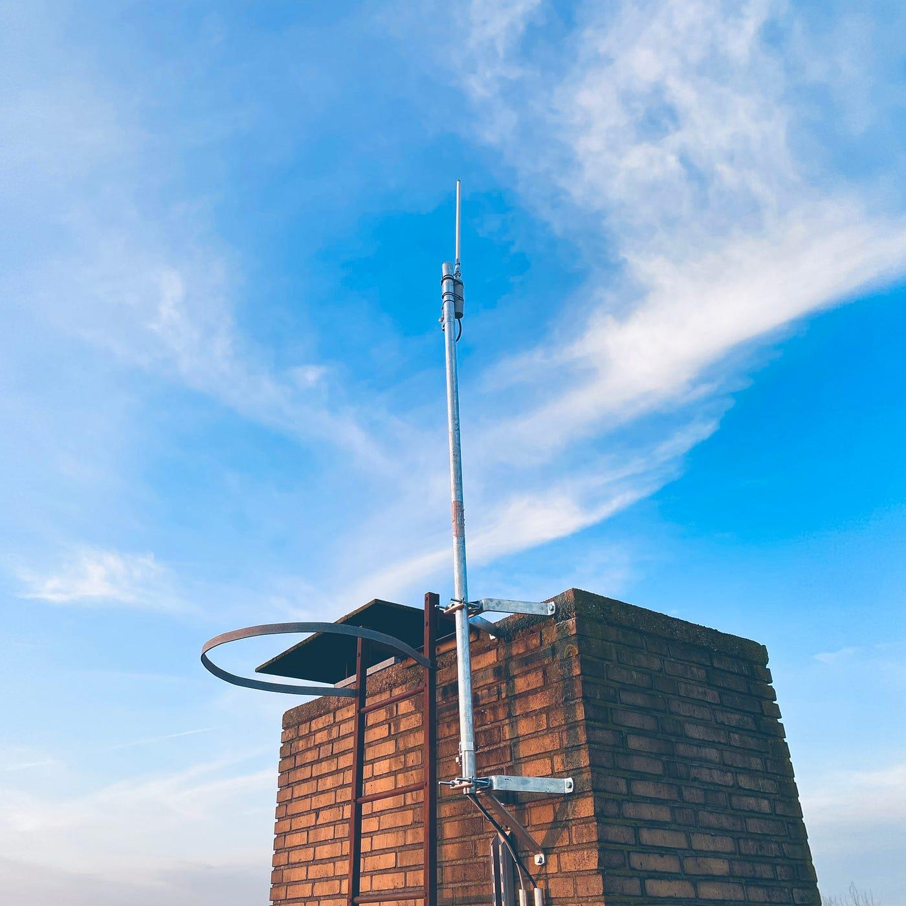
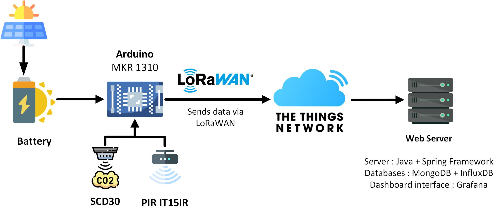

# LoRaWAN Implementation Guide

## PART 1: Understanding LoRa and LoRaWAN
LoRa (Long Range) is a wireless communication technology designed for IOT devices that need to transmit small amounts of data over long range distances while consuming very little power.

Example 
_Imagine you have a temperature sensor installed on a farm. You want it to send temperature readings to your computer, but the sensor is several kilometers away._

Using ordinary Wi-Fi may not be practical because:
* Wi-Fi has relatively limited coverage.
* It consumes more power.
* The sensor may not have access to a Wi-Fi network.

LoRa solves this by allowing devices to communicate over longer range distances with low power consumptions.

Example applications:

* Smart agriculture: Monitoring soil moisture and temperature.
* Smart cities: Monitoring waste bins.
* Environmental monitoring: Measuring air quality.
* Smart buildings: Monitoring humidity and temperature.
* Asset tracking: Tracking equipment and containers. 


<p><strong>LoRa Gateway </strong></p> 




### What is LoRaWAN?
LoRa and LoRaWAN are related, but they are not the same thing.

| LoRa | LoRaWAN |
| --- | --- |
| Wireless radio technology | Communication protocol |
| Handles physical wireless transmission | Handles network communication |
| Defines how radio signals are transmitted | Defines how devices communicate with the network |
| Provides long-range communication | Provides device authentication, security, and network management |

Simple analogy:

Think of LoRa as the road on which vehicles travel, while LoRaWAN is the traffic system that manages how the vehicles communicate and move.

Remember:
* LoRa = Physical radio communication. 
* LoRaWAN = Network protocol built around LoRa.

### Understanding the LoRaWAN architecture


**_Understanding each component_**

**1. End device**

This is the physical IoT device containing a microcontroller and sensors.

For example:

* ESP32
* Arduino
* Temperature sensor
* Humidity sensor
* CO₂ sensor

Its job is to collect information and transmit it using LoRa.

**2. LoRaWAN Gateway**

The gateway acts as a bridge between the LoRa radio network and the internet.

It receives LoRa messages from multiple devices and forwards them to the network server.
- An important distinction: the gateway does not normally interpret the application data. That is handled further along the network.

**3. Network Server**
The Network Server manages the LoRaWAN network.

Its responsibilities include:
* Managing device communication.
* Checking message integrity and security.
* Handling duplicate messages received by multiple gateways.
* Managing message routing.

**4. Application Server**

The Application Server handles application-level data and makes it available to applications through integrations and APIs.

**5. Applications**

These are the interfaces used to view or process the information.

For example, a dashboard could display:

| Sensor | Reading |
| --- | --- |
| Temperature | 25.4°C |
| Humidity | 60% |
| CO₂ | 420 ppm |


### Understanding the complete program flow
Lab Exercise 

```bash
iotsuwo-hs-2026-course-main-lora/
│
└── lora/
    │
    ├── README.md
    │
    └── lora-grove-extension-board/
        │
        ├── libraries/
        │   ├── Adafruit_CCS811-master/
        │   ├── Adafruit_Si7021-master/
        │   └── arduino-lmic-master/
        │
        └── ttn-otaa/
            └── ttn-otaa.ino
```


Configure an Arduino LoRaWAN device, connect it to The Things Stack, collect environmental sensor readings and successfully transmit the readings to the TTN application.




_What you need before starting_

Hardware

* Arduino Uno.
* LoRa development board / Grove LoRa extension board.
* Si7021 temperature and humidity sensor.
* CCS811 CO₂ sensor.
* USB cable.
* Computer.

Software
- Arduino IDE.
- The Things Stack (TTN) account.
- Arduino LMIC library.
- Adafruit CCS811 library.
- Adafruit Si7021 library.


Navigate to:

```bash
lora/
  lora-grove-extension-board/
    ttn-otaa/
      ttn-otaa.ino
```

Open `ttn-otaa.ino` using Arduino IDE.


